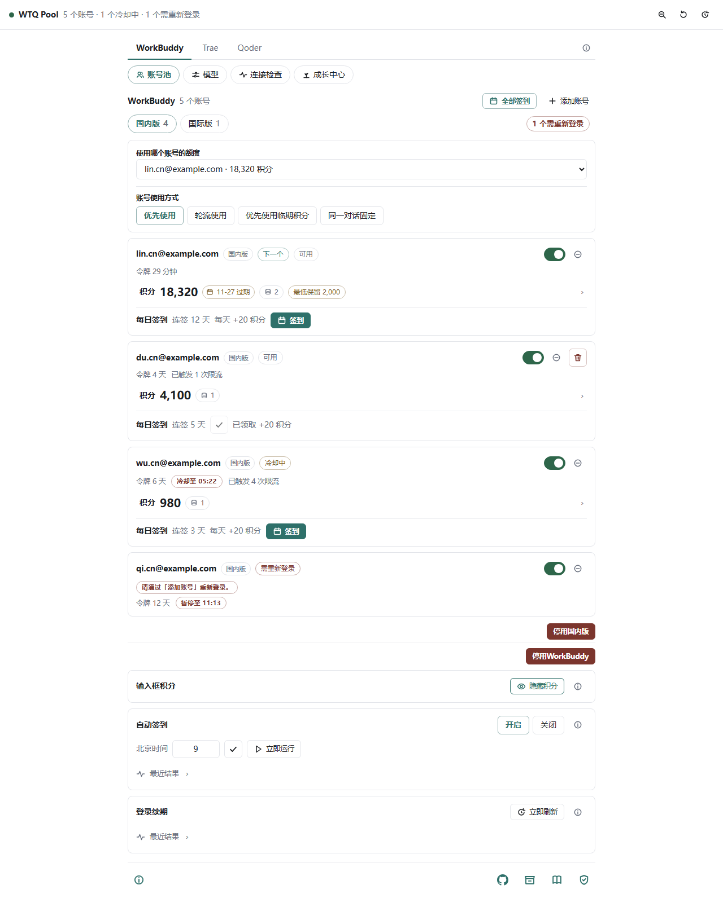

<p align="center">
  <picture>
    <source media="(prefers-color-scheme: dark)" srcset="https://github.com/chengzhi-c/pi-desktop-wtq-pool/raw/main/docs/logo-dark.png">
    <source media="(prefers-color-scheme: light)" srcset="https://github.com/chengzhi-c/pi-desktop-wtq-pool/raw/main/docs/logo.png">
    
  </picture>
</p>

<h1 align="center">WTQ Pool</h1>

<p align="center"><sub>PI-Desktop edition · <a href="https://github.com/chengzhi-c/dsh-wtq-pool">DeepSeek Harness edition</a></sub></p>

<p align="center"><b>Use local WorkBuddy, Trae and Qoder accounts in PI-Desktop, with account failover based on each source's rules.</b></p>

<p align="center">
  <b>English</b> | <a href="README.md">简体中文</a>
</p>

<p align="center">
  <a href="#install">Install</a> ·
  <a href="#usage">Usage</a> ·
  <a href="#features">Features</a> ·
  <a href="#settings">Settings</a> ·
  <a href="CHANGELOG.md">Changelog</a> ·
  <a href="https://github.com/chengzhi-c/pi-desktop-wtq-pool/issues">Issues</a>
</p>

<p align="center">
  <a href="https://github.com/chengzhi-c/pi-desktop-wtq-pool/releases"></a>
  <a href="LICENSE"></a>
</p>

> For learning use only. Unofficial clients may trigger account restrictions. Review the risks and follow the relevant service terms.

WTQ Pool registers model groups by source and region. When an account is rate-limited, out of credits or signed out, the plugin switches accounts according to that source's rules.

## Install

1. Download `io.github.chengzhi-c.pi-desktop-wtq-pool-<version>.piplug` from [Releases](https://github.com/chengzhi-c/pi-desktop-wtq-pool/releases).
2. In PI-Desktop, open **Extensions**, open the top-right more menu, select **Install package**, and choose the downloaded file.
3. Reload WTQ Pool. Restart PI-Desktop if the installed version is not shown.

Requires PI-Desktop 0.15.0 or later. After upgrading from 1.1.x to 1.2.0, provider IDs changed to `wtqpool-*`; select your models again.

## Usage

In PI-Desktop 0.22 or later, press `Alt+Space` to open the launcher, or run `WTQ Pool: Open panel` from the command palette (command ID: `wtqpool.open`).

Sign in to WorkBuddy, Trae or Qoder, then select **Detect accounts again**. WorkBuddy supports multiple sign-ins; domestic Trae reads Trae CN and TRAE SOLO CN separately. Each Qoder installation and the international WorkBuddy edition retain one sign-in, so switching accounts replaces it.

WorkBuddy 5.6+ `$wbEncrypted` sign-ins require a key from the local WorkBuddy installation. On Windows, the plugin uses a signed executable with a supported public key on a fixed local drive; elevated processes skip decryption. On macOS, it runs the local app to read the key without verifying its signature; root processes on macOS and Linux also skip decryption. Use a trusted installation.

The panel provides the account pool, models, connection check and growth centre. Each model group publishes up to 64 models. Automatic check-in is off by default, defaults to 09:00 Beijing time and can be changed in the panel; check-in and WorkBuddy **Run now** may consume make-up cards or lottery draws. **Refresh now** renews plugin-owned sign-ins issued at least six hours ago or expiring within five minutes; the desktop app renews its active sign-in.

### Add an account

Add an account through the official sign-in page in the panel, or import an `.info` file containing `{auth, account}`. Run this from a source checkout:

```powershell
$storageFile = Join-Path $env:APPDATA "PI-Desktop\storage-location.json"
$piData = if (Test-Path $storageFile) { (Get-Content $storageFile -Raw | ConvertFrom-Json).roots.data } else { Join-Path $HOME ".pi-desktop" }
$pluginData = Join-Path $piData "plugins\data\io.github.chengzhi-c.pi-desktop-wtq-pool"
$accountFile = Read-Host "Sign-in file path"
node .\tools\import-signins.cjs --data $pluginData --from $accountFile
```

Optional arguments: `--region cn|global|all`, `--dry-run`, `--force`.

Files in `signins/` contain usable access and refresh tokens; protect them like account passwords. Panel-added sign-ins can be deleted after two confirmations; the desktop app's active sign-in cannot be deleted from the panel.

## Features

- Distribution: priority, round robin and expiring credits first. WorkBuddy also supports conversation-sticky routing.
- Composer credits: show the current account's balance and switch accounts by clicking the readout; with the readout off, balance polling runs every five minutes.
- Model catalogues load at startup and refresh on demand when their cache expires; disabled or signed-out accounts are not probed.
- Gateways return SSE `chat.completion.chunk` responses.

### Failover and recovery

| Condition | Behaviour |
| --- | --- |
| Invalid request, or Trae/Qoder model missing from the catalogue | Return 400 or 404 without sending a chat request |
| WorkBuddy rate limit, upstream 5xx or host unavailable | Try the next account; rate limits follow the upstream wait time or configured cooldown |
| WorkBuddy exhausted credits | Hold the account for up to six hours; a positive balance or manual cooldown reset releases the hold |
| WorkBuddy expired sign-in | Hold the account for up to six hours; a successful refresh, a new sign-in or manual cooldown reset releases the hold |
| WorkBuddy plan excludes a model (11158) | Disable that model on the account for 24 hours; return 400 if no account supports it |
| Trae/Qoder authentication failure, rate limit, exhausted credits or empty response | Try the next sign-in and lower its priority for the cooldown; a sole sign-in is still used |
| Trae/Qoder upstream 5xx | Return the upstream failure |

Trae and Qoder cooldowns default to 60 seconds and can be set up to 24 hours. An expired WorkBuddy sign-in triggers one refresh and retry; domestic WorkBuddy error 11128 retries once after adjusting the conversation format.

## Settings

The host settings page provides the options below; their definitions and defaults are in [`manifest.json`](manifest.json).

| Setting | Default | Purpose |
| --- | --- | --- |
| `enabled` | `true` | Enable the gateways |
| `sourceWorkbuddy` / `sourceTrae` / `sourceQoder` | `true` | Enable the corresponding source |
| `distribution` | `priority` | WorkBuddy routing: `priority`, `round-robin`, `expiry` or `sticky` |
| `cooldownSeconds` | `60` | Rate-limit cooldown |
| `authFile` | `""` | WorkBuddy sign-in file; empty enables discovery |
| `showComposerPoints` | `false` | Show the current account's credits in the composer |

The panel also edits distribution, source switches, regional preferences, credit reserves, model publishing and automatic check-in.

## Ports

| Source | Domestic | International |
| --- | ---: | ---: |
| WorkBuddy | `41831` | `41841` |
| Trae | `41851` | `41861` |
| Qoder | `41871` | `41881` |

If a preferred port is occupied, the gateway uses an ephemeral port and the connection check reports the actual address. The DeepSeek Harness edition uses a separate range starting at `42831`; the editions keep settings and credentials separately. Sharing a WorkBuddy sign-in can let refresh-token rotation invalidate the other edition.

## Privacy and network access

Conversation content is sent to the selected vendor and is not saved as local history. Requests also carry the selected vendor's account and device identifiers (account uid, machine id, device id), as the vendor's own desktop client does.

Sign-in files and archives contain usable tokens, have no additional encryption and rely on OS file permissions. Archives are retained for 30 days after the later access-token or refresh-token expiry; records without an expiry are cleared when the account is deleted. Reading a Qoder sign-in on macOS accesses the login Keychain and may prompt for access.

PI-Desktop does not sandbox plugin processes at the OS level. Gateways listen on `127.0.0.1`, but other local processes can call them and spend account quota. On Windows, restrict the plugin data directory ACL to the current user.

Tokens are sent only to these hosts:

- WorkBuddy: `copilot.tencent.com`, `www.codebuddy.cn`, `www.codebuddy.ai`, `www.workbuddy.ai`
- Trae: `api.trae.cn`, `solo.trae.cn`, `trae-api-cn.mchost.guru`, `coresg-normal.trae.ai`, `growsg-normal.trae.ai`
- Qoder: `gateway.qoder.com.cn`, `openapi.qoder.com.cn`, `api3.qoder.sh`, `openapi.qoder.sh`

## Preview



The [live preview](https://chengzhi-c.github.io/pi-desktop-wtq-pool/) uses the actual panel code with demo data. The in-app panel follows PI-Desktop's theme and language.

## Development

```sh
npm ci
npm run typecheck
npm run build
npm test
```

The test suite requires Node 22.15 or newer. After editing `src/`, run `npm run build` to update `lib/`. Include `THIRD-PARTY-NOTICES.md` in the package staging directory. From the PI-Desktop source repository root, use `pnpm pi-plugin check <staging-dir>` and `pnpm pi-plugin pack <staging-dir>` to validate and package the plugin. See the [plugin development guide](https://github.com/vastsa/PI-Desktop/blob/HEAD/docs/plugin-development.md).

## Credits

| Project | Contribution |
| --- | --- |
| [eric8bit/pi-desktop-workbuddy](https://github.com/eric8bit/pi-desktop-workbuddy) | PI-Desktop WorkBuddy porting source |
| [XDTrees/dsh-workbuddy-xdpool](https://github.com/XDTrees/dsh-workbuddy-xdpool) | WorkBuddy account-pool base |
| [corrinehu/dsh-workbuddy-connect](https://github.com/corrinehu/dsh-workbuddy-connect) | Loopback endpoint security model |
| [dingminhua/dsh-connect-workbuddy](https://github.com/dingminhua/dsh-connect-workbuddy) | WorkBuddy API and error-classification reference |
| [dingminhua/dsh-connect-trae](https://github.com/dingminhua/dsh-connect-trae) | Trae protocol reference |
| [eghrhegpe/dsh-connect-qoder](https://github.com/eghrhegpe/dsh-connect-qoder) | Qoder protocol reference |
| [ardeyouxipianyi/workbuddy2api-hub](https://github.com/ardeyouxipianyi/workbuddy2api-hub) | Growth-centre and credential-retention reference |

Copyright and MIT license notices for ported code shipped with the plugin are in [THIRD-PARTY-NOTICES.md](THIRD-PARTY-NOTICES.md).

## License

This project is licensed under MIT; see [LICENSE](./LICENSE). Notices for ported code shipped with the plugin are in [THIRD-PARTY-NOTICES.md](THIRD-PARTY-NOTICES.md).
