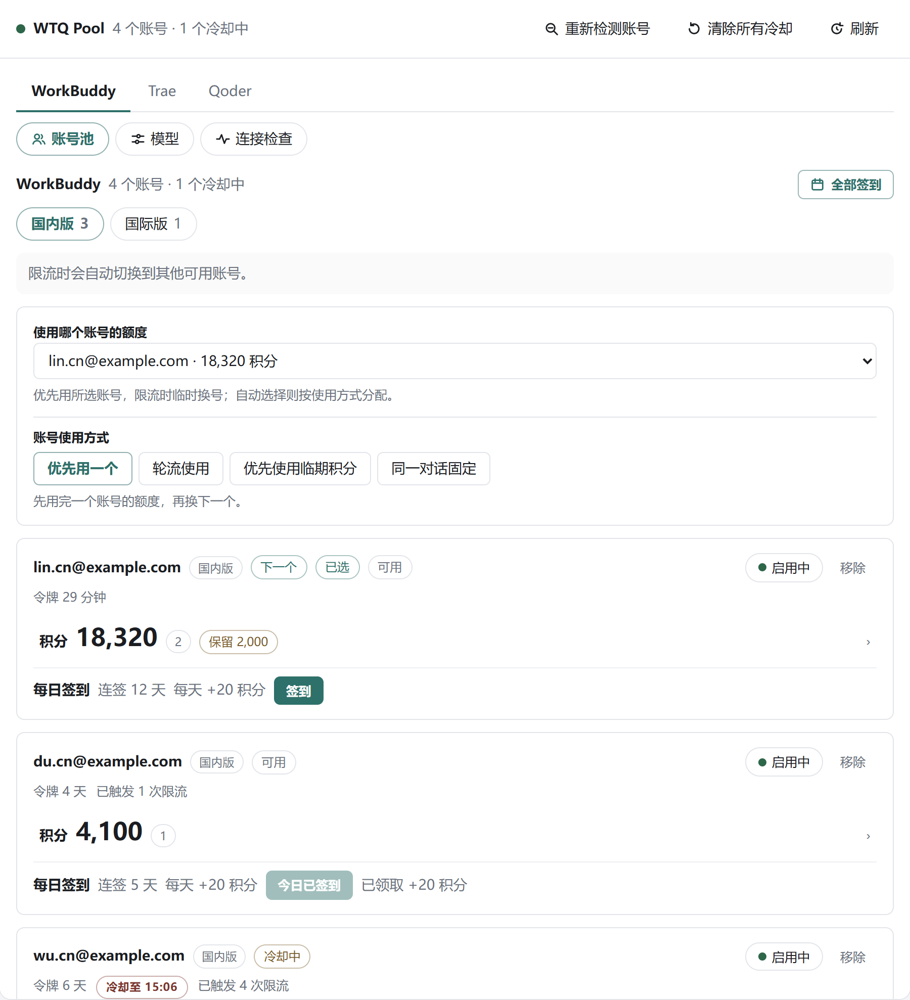
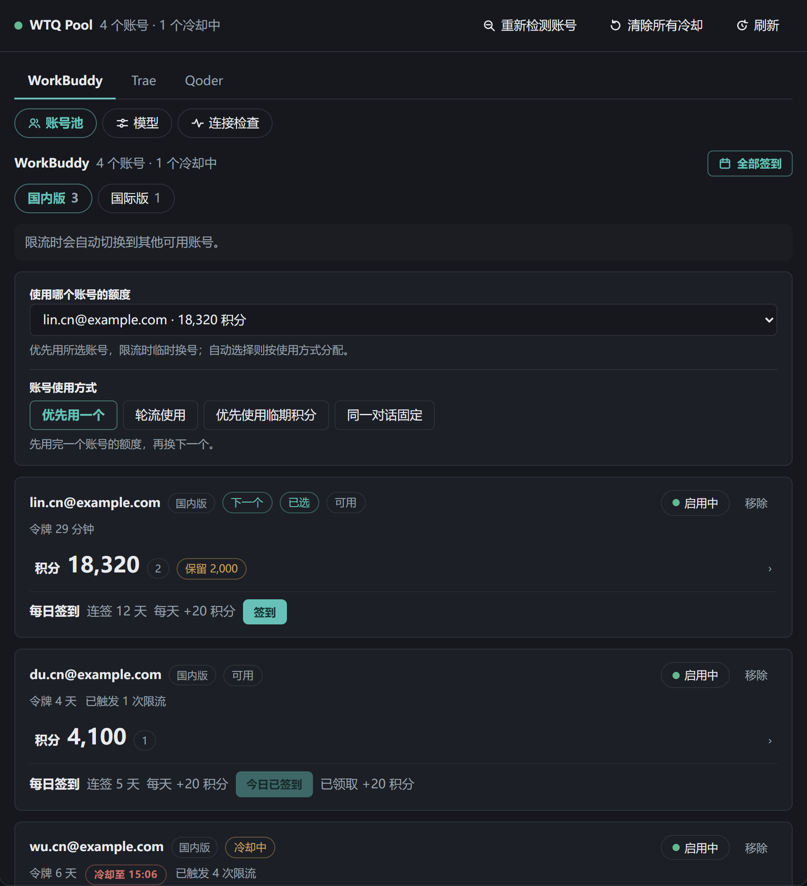
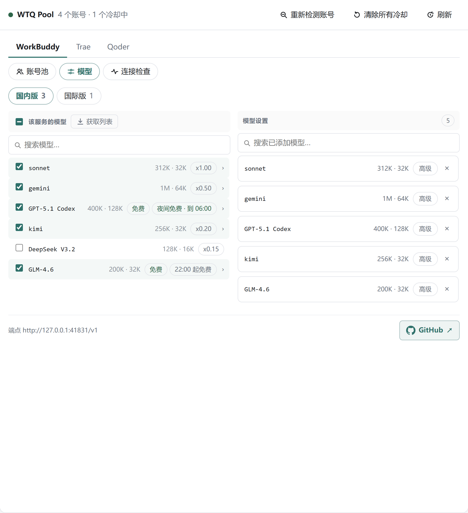
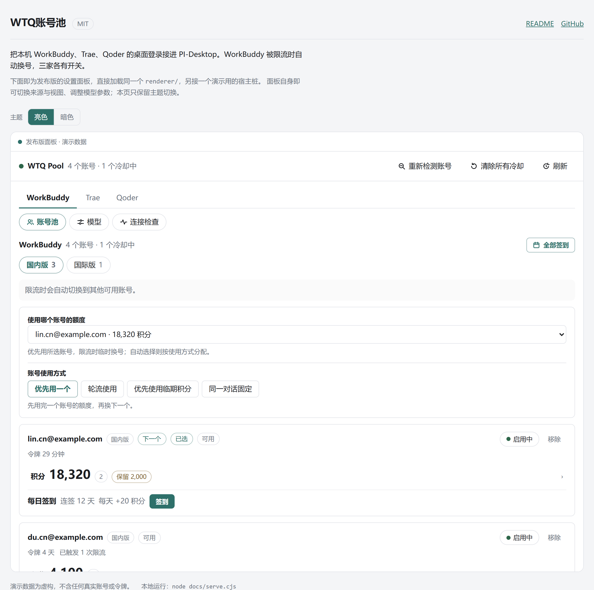
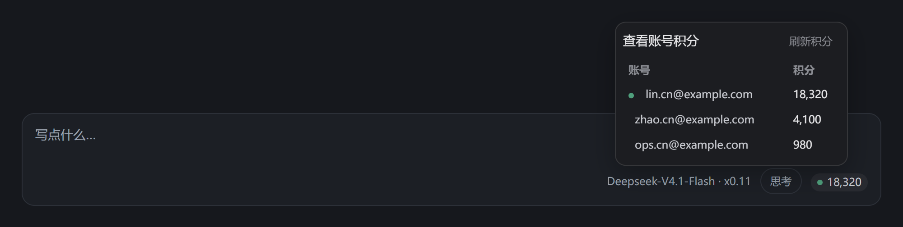

# WTQ账号池

把本机 WorkBuddy、Trae、Qoder 的桌面登录接入 PI-Desktop。WorkBuddy 被限流或额度用尽时自动换号；Trae、Qoder 按请求选择账号，不保证失败后重试。三个来源独立开关，国内与国际账号分别成组。

[English](./README.en.md)

## 预览

设置面板界面如下（默认亮色）：



面板跟随 PI-Desktop 的外观设置，暗色与亮色各一套配色：



模型页可以改显示名、上下文窗口、输出上限、思考等级和贴图。Trae 目录给出费率的模型会带上 `x0.79` 这样的费率标签，未给出费率的模型（以及 Qoder 全部模型）不标注：



在线预览：<https://chengzhi-c.github.io/pi-desktop-wtq-pool/>。

`docs/index.html` 加载实际面板代码并使用虚构演示数据，支持来源切换、模型设置和主题预览，不读取本机账号或令牌。



开启 `showComposerPoints` 后，输入框工具栏显示当前模型的账号积分，点击可查看该组账号并切换账号。下图由实际输入框扩展离屏渲染，非对话测试截图：



本地运行：`node docs/serve.cjs`，然后打开它输出的地址。
（`docs/index.html` 需经本地服务器打开：`file://` 页面无法读取同目录的面板文件。）

## 安装

PI-Desktop → 插件 → 安装本地插件，选择本地生成的 `.piplug`。

开发与检查：`npm ci && npm run typecheck && npm run build && npm test`。修改 `src/` 后须重建 `lib/`。
打包使用 PI-Desktop 的 `PluginCheck` / `PluginPack`，不使用通用 ZIP 工具。打包前先把工作树复制成仅含运行时文件的副本（去掉 `src/`、`tests/`、`build.mjs`、`tsconfig.json`、`package-lock.json`），并清空 `manifest.json` 的 `contributes.providers`：`PluginPack` 只排除 `.git`、`node_modules` 和 `dist`，运行时声明里带着本机上一次发布的模型组与端口，直接打包会把它带进发布产物。

## 使用

在各家桌面 App 里登录，再点面板「重新检测账号」。WorkBuddy 要多个账号，就在 App 里逐个登录；5.6 起的 `$wbEncrypted` 登录由插件向本机已安装的 WorkBuddy 要密钥再读。Trae 国内版有 Trae CN 与 TRAE SOLO CN 两个登录位，Qoder 每个安装只保存一个登录，在 App 里重新登录会覆盖前一个。

模型分组没出现时，按面板顶部的提示重启 PI-Desktop。

面板顶层选来源，下面是账号池、模型和连接检查。

- 账号卡支持积分明细、签到、停用、移除和区域首选账号；输入框积分弹窗可刷新当前模型所在组。
- WorkBuddy 支持优先使用、轮询、临期积分优先和会话固定账号；Trae、Qoder 支持轮询与临期积分优先。
- 模型页保存后更新插件声明；宿主尚未重载时按面板提示重启。一个模型组最多发布 64 个，超出的勾选标为「未发布」，网关仍支持这些模型。
- 自动签到默认关闭，开启后默认于 09:00（北京时间）执行；错过时段将在下次启动补领。「立即运行」执行同一轮，包含三家的签到、WorkBuddy 国内账号的连登和任务奖励及猫猫旅行。Trae 每日签到按设备限制，Qoder 新轮次于 10:00 开放。

## 设置

插件页里可改的项：

| 键 | 默认 | 说明 |
| --- | --- | --- |
| `enabled` | `true` | 关闭后网关不启动 |
| `sourceWorkbuddy` / `sourceTrae` / `sourceQoder` | `true` | 关闭后该来源不扫描、不发布、不请求 |
| `distribution` | `priority` | WorkBuddy 池的发放方式：`priority` 先用一个账号，`round-robin` 均摊，`expiry` 优先消耗临期积分，`sticky` 同一对话固定 |
| `sourceDistributions` | `{}` | Trae、Qoder 的分发方式：`round-robin` / `expiry`；兼容旧值 `priority` |
| `cooldownSeconds` | `60` | 限流冷却时长。上游报出重置时间时以它为准，按北京时间 |
| `creditReserves` | `{}` | 按账号 id 设定的积分保底，余额低于它的账号不参与分发 |
| `authFile` | `""` | WorkBuddy 登录文件路径；扫描其所在目录的全部 `.info` 登录，留空自动发现 |
| `autoCheckin` | `{"enabled":false,"hours":[9]}` | 自动签到的开关与时点；`hours` 为北京时间整点，留空用 09:00 |
| `showComposerPoints` | `false` | 在输入框工具栏显示当前账号积分 |

模型勾选和首选账号由面板保存。命令面板里也可以打开面板、重新检测、清除冷却、全部签到、连接检查。

## 端口

```
WorkBuddy  41831 / 41841
Trae       41851 / 41861
Qoder      41871 / 41881
```

宿主在插件进程启动前读取清单地址，因此端口固定。端口被占用时请先查看连接检查，不应连接其他进程的服务。国内模型仅使用国内账号。

## 数据

只读三家 App 的本机登录文件。令牌仅在插件进程中使用，并发往对应厂商接口；网关仅监听 `127.0.0.1`，同机其他进程仍可调用并消耗账号额度。插件设置由宿主持久化，模型分组写入本插件清单；插件不直接管理或删除宿主会话记录。重启后回复缺失时应同时检查插件流是否完成与宿主持久化日志。

## 权限

| 权限 | 用途 |
| --- | --- |
| `ui.panel` | 打开设置面板 |
| `background.service` | 常驻运行网关与扫描 |
| `provider.register` | 把三个来源作为模型提供方写进本插件清单 |
| `renderer.extension` | 在输入框工具栏显示积分 |
| `shell.openExternal` | 面板页脚打开外部链接 |
| `clipboard.write` | 连接检查页复制报告 |

出网请求由插件进程直接发送，不经过宿主 `net.fetch` 通道。

令牌只会发往以下主机，与 `manifest.json` 的 `safetyNotes` 一致：

- WorkBuddy：`copilot.tencent.com`、`www.codebuddy.cn`、`www.codebuddy.ai`、`www.workbuddy.ai`、`www.workbuddy.cn`
- Trae：`api.trae.cn`、`solo.trae.cn`、`trae-api-cn.mchost.guru`、`coresg-normal.trae.ai`、`growsg-normal.trae.ai`
- Qoder：`gateway.qoder.com.cn`、`openapi.qoder.com.cn`、`api3.qoder.sh`、`openapi.qoder.sh`

## 致谢

本插件的若干模块移植或参考自下列 MIT 项目，特此鸣谢：

| 项目 | 版权 | 用于 |
| --- | --- | --- |
| [XDTrees/dsh-workbuddy-xdpool](https://github.com/XDTrees/dsh-workbuddy-xdpool) | (c) 2026 XDTrees | WorkBuddy 账号池与整体移植来源 |
| [corrinehu/dsh-workbuddy-connect](https://github.com/corrinehu/dsh-workbuddy-connect) | (c) 2026 Corrine Hu | 回环端点的安全模型 |
| [dingminhua/dsh-connect-workbuddy](https://github.com/dingminhua/dsh-connect-workbuddy) | (c) 2026 LaoDing | 上游接口与错误分类 |
| [dingminhua/dsh-connect-trae](https://github.com/dingminhua/dsh-connect-trae) | (c) 2026 dingminhua | Trae 协议参考 |
| [eghrhegpe/dsh-connect-qoder](https://github.com/eghrhegpe/dsh-connect-qoder) | (c) 2026 eghrhegpe | Qoder 协议参考 |
| [eric8bit/pi-desktop-workbuddy](https://github.com/eric8bit/pi-desktop-workbuddy) | (c) 2026 eric8bit | 同一上游的 PI-Desktop 移植版，本插件的前身 |

## 许可

MIT，见 [LICENSE](./LICENSE)。
