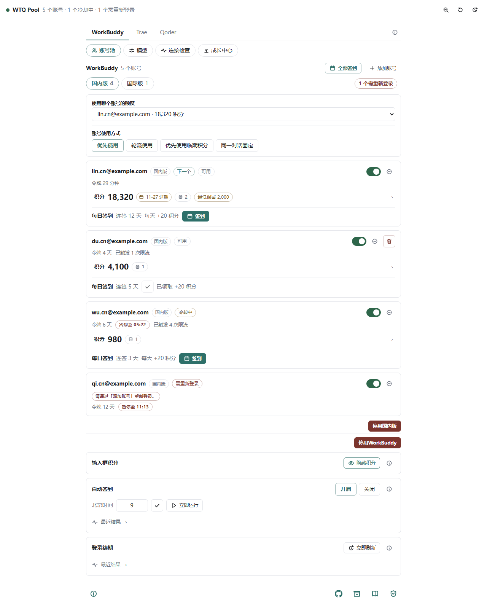
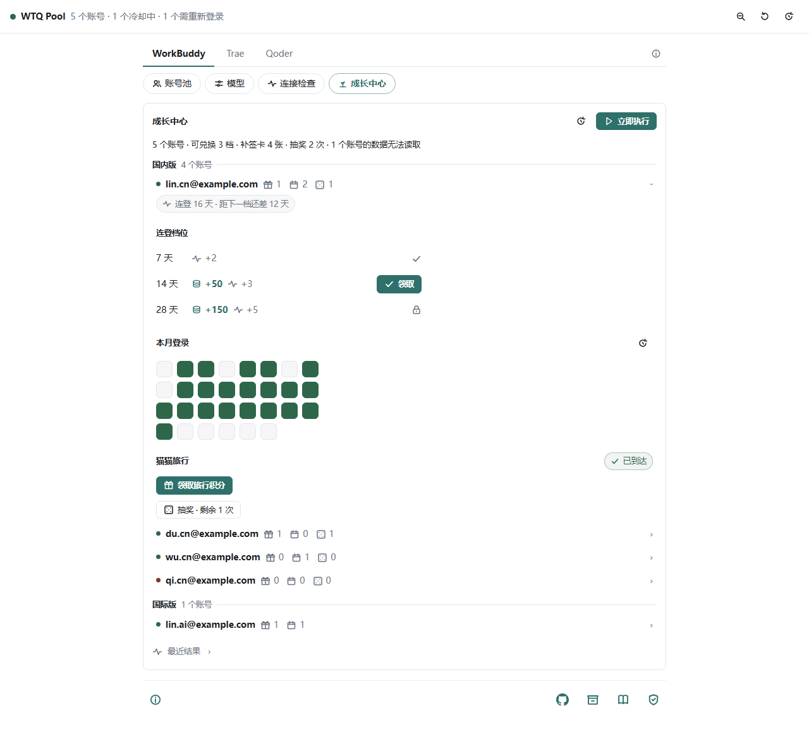

<p align="center">
  <picture>
    <source media="(prefers-color-scheme: dark)" srcset="https://github.com/chengzhi-c/pi-desktop-wtq-pool/raw/main/docs/logo-dark.png">
    <source media="(prefers-color-scheme: light)" srcset="https://github.com/chengzhi-c/pi-desktop-wtq-pool/raw/main/docs/logo.png">
    
  </picture>
</p>

<h1 align="center">WTQ Pool</h1>

<p align="center"><sub>PI-Desktop 版 · <a href="https://github.com/chengzhi-c/dsh-wtq-pool">DeepSeek Harness 版</a></sub></p>

<p align="center"><b>在 PI-Desktop 中使用本机 WorkBuddy、Trae 和 Qoder 账号，并在账号不可用时自动切换。</b></p>

<p align="center">
  <a href="README.en.md">English</a> | <b>简体中文</b>
</p>

<p align="center">
  <a href="#安装">安装</a> ·
  <a href="#使用">使用</a> ·
  <a href="#功能">功能</a> ·
  <a href="#设置">设置</a> ·
  <a href="CHANGELOG.md">更新日志</a> ·
  <a href="https://github.com/chengzhi-c/pi-desktop-wtq-pool/issues">问题反馈</a>
</p>

<p align="center">
  <a href="https://github.com/chengzhi-c/pi-desktop-wtq-pool/releases"></a>
  <a href="LICENSE"></a>
</p>

> 本项目仅供学习使用。非官方客户端可能触发厂商的账号限制。使用前请评估风险并遵守相关服务条款。

插件按来源和区域注册模型组。账号限流、额度耗尽或登录失效时，按来源规则切换账号。

## 安装

1. 从 [Releases](https://github.com/chengzhi-c/pi-desktop-wtq-pool/releases) 下载 `io.github.chengzhi-c.pi-desktop-wtq-pool-<版本>.piplug`。
2. 在 PI-Desktop「扩展」页打开右上角更多菜单，选择「安装插件包」，选中下载的文件。
3. 重新启用 WTQ Pool 或重启 PI-Desktop，以刷新提供商列表。

需要 PI-Desktop 0.15.0 或更高版本。从 1.1.x 升级到 1.2.0 后，提供商 ID 改为 `wtqpool-*`，请重新选择模型。

## 使用

PI-Desktop 0.22 起可按 `Alt+Space` 打开启动器，或从命令面板运行 `WTQ Pool: Open panel`（命令 ID：`wtqpool.open`）。

在 WorkBuddy、Trae 或 Qoder 桌面应用中登录后，在面板中点击「重新检测账号」。WorkBuddy 支持多个登录；国内 Trae 分别读取 Trae CN 和 TRAE SOLO CN。每个 Qoder 安装及 WorkBuddy 国际版各保留一个登录，登录其他账号会替换当前账号。

WorkBuddy 5.6 起的 `$wbEncrypted` 登录需要本机应用的解密密钥。Windows 只使用签名有效且公钥受支持的本地安装，管理员进程跳过解密；macOS 会运行本机应用读取密钥，不校验签名，root 进程跳过解密。请使用可信的 WorkBuddy 安装。

面板提供账号池、模型、连接检查和成长中心。每个模型组最多发布 64 个模型。自动签到默认关闭，时间为北京时间 09:00，可在面板修改。签到和「立即执行」可能消耗补签卡或抽奖机会；「立即刷新」仅续期签发满六小时或五分钟内到期的插件管理登录，桌面应用管理的登录由应用续期。

### 添加账号

在面板通过官方登录页添加账号，或导入含 `{auth, account}` 的 `.info` 文件。从源码仓库运行：

```powershell
$storageFile = Join-Path $env:APPDATA "PI-Desktop\storage-location.json"
$piData = if (Test-Path $storageFile) { (Get-Content $storageFile -Raw | ConvertFrom-Json).roots.data } else { Join-Path $HOME ".pi-desktop" }
$pluginData = Join-Path $piData "plugins\data\io.github.chengzhi-c.pi-desktop-wtq-pool"
$accountFile = Read-Host "账号文件路径"
node .\tools\import-signins.cjs --data $pluginData --from $accountFile
```

可选参数：`--region cn|global|all`、`--dry-run`、`--force`。

`signins/` 含可用的访问令牌和刷新令牌，应按账号密码保护。删除面板添加的登录需要再次确认；桌面应用当前使用的登录不能从面板删除。

展开账号可查看本月登录状态：绿色表示已登录，灰色表示未登录，悬停日期可查看日期。成长中心支持领取连登档位和旅行积分、选择旅行地点、单次抽奖及补签。「立即执行」批量处理猫猫旅行和成长奖励；补签、抽奖和派遣会先确认消耗。功能可用性因地区而异。

## 功能

- 账号分配：支持优先使用、轮流使用和临期积分优先；WorkBuddy 另支持同一对话固定账号。
- 输入框积分：显示当前账号积分，点击读数后可以更换账号。
- 模型目录：启动时加载，过期后按需刷新；停用或登录失效的账号不参与探测。
- 网关：始终以 SSE 返回 `chat.completion.chunk`。

PI-Desktop 将「关闭思考」和「省略」编码为相同请求；Qoder 可关闭思考的模型将两者均按关闭处理。

PI-Desktop 0.24.0-beta.1 会忽略 WorkBuddy 的 DeepSeek 思考档位；该功能需要宿主支持插件的思考参数能力声明。

### 账号切换与恢复

| 情况 | 处理 |
| --- | --- |
| 请求无效，或 Trae、Qoder 模型不在目录 | 返回 400 或 404，不发送对话 |
| WorkBuddy 限流、5xx 或主机不可达 | 尝试下一个账号；限流按上游等待时间或冷却处理 |
| WorkBuddy 额度耗尽 | 最长暂停六小时；读到正余额或手动清除冷却后恢复 |
| WorkBuddy 登录失效 | 最长暂停六小时；成功刷新令牌、重新登录或手动清除冷却后恢复 |
| WorkBuddy 套餐不支持模型（11158） | 该账号对此模型暂停 24 小时；全部账号均不支持时返回 400 |
| Trae、Qoder 认证失败、限流、额度耗尽或空响应 | 尝试下一个账号，并按冷却降低该账号优先级；仅剩一个账号时仍会使用 |
| Trae、Qoder 上游 5xx | 返回上游错误 |

Trae、Qoder 冷却默认 60 秒，最长 24 小时。WorkBuddy 登录失效时刷新令牌并重试一次；国内 WorkBuddy 返回 11128 时调整对话格式后重试一次。

## 设置

宿主设置页提供以下选项，定义与默认值见 [`manifest.json`](manifest.json)。

| 设置 | 默认值 | 用途 |
| --- | --- | --- |
| `enabled` | `true` | 启用网关 |
| `sourceWorkbuddy` / `sourceTrae` / `sourceQoder` | `true` | 启用对应来源 |
| `distribution` | `priority` | WorkBuddy 分发：`priority`、`round-robin`、`expiry` 或 `sticky` |
| `cooldownSeconds` | `60` | 限流冷却时间 |
| `authFile` | `""` | WorkBuddy 登录文件；留空时自动发现 |
| `showComposerPoints` | `false` | 在输入框显示当前账号积分 |

面板也可修改分发方式、来源开关、区域首选、积分保底、模型发布和自动签到。

## 端口

| 来源 | 国内 | 国际 |
| --- | ---: | ---: |
| WorkBuddy | `41831` | `41841` |
| Trae | `41851` | `41861` |
| Qoder | `41871` | `41881` |

连接检查提示端口被占用时，请暂停使用受影响的模型，释放端口后重启 PI-Desktop。DeepSeek Harness 版使用 `42831` 起始的独立端口范围；两版设置和凭证分开，共用 WorkBuddy 登录时刷新令牌轮换可能使另一版失效。

## 隐私与出网

会话内容会发送给所选厂商，不保存为本地历史。请求同时携带所选厂商的账号与设备标识（账号 UID、机器码、设备 ID），与厂商桌面客户端一致。

登录文件和归档含可用令牌，未额外加密，依赖操作系统权限保护。归档在访问令牌或刷新令牌中较晚的到期时间后保留 30 天；未记录到期时间的归档在删除账号时清除。macOS 读取 Qoder 登录时会访问登录钥匙串，系统可能请求授权。

PI-Desktop 不提供系统级沙箱。网关只监听 `127.0.0.1`，同机进程仍可调用并消耗账号额度；Windows 下请确保插件数据目录 ACL 仅允许当前用户访问。

令牌仅发送至以下主机：

- WorkBuddy：`copilot.tencent.com`、`www.codebuddy.cn`、`www.codebuddy.ai`、`www.workbuddy.ai`
- Trae：`api.trae.cn`、`solo.trae.cn`、`trae-api-cn.mchost.guru`、`coresg-normal.trae.ai`、`growsg-normal.trae.ai`
- Qoder：`gateway.qoder.com.cn`、`openapi.qoder.com.cn`、`api3.qoder.sh`、`openapi.qoder.sh`

## 预览





[在线预览](https://chengzhi-c.github.io/pi-desktop-wtq-pool/) 使用实际面板代码和演示数据。应用内面板跟随 PI-Desktop 的主题和语言。

## 开发

```sh
npm ci
npm run typecheck
npm run build
npm test
```

测试需要 Node 22.15 或更高版本。修改 `src/` 后运行 `npm run build` 更新 `lib/`。打包暂存目录需包含 `THIRD-PARTY-NOTICES.md`；从 PI-Desktop 源码仓库根目录使用 `pnpm pi-plugin check <目录>` 和 `pnpm pi-plugin pack <目录>` 检查并打包，详见 [插件开发文档](https://github.com/vastsa/PI-Desktop/blob/HEAD/docs/plugin-development.md)。

## 致谢

| 项目 | 内容 |
| --- | --- |
| [eric8bit/pi-desktop-workbuddy](https://github.com/eric8bit/pi-desktop-workbuddy) | PI-Desktop WorkBuddy 移植来源 |
| [XDTrees/dsh-workbuddy-xdpool](https://github.com/XDTrees/dsh-workbuddy-xdpool) | WorkBuddy 账号池基础实现 |
| [corrinehu/dsh-workbuddy-connect](https://github.com/corrinehu/dsh-workbuddy-connect) | 回环端点安全模型 |
| [dingminhua/dsh-connect-workbuddy](https://github.com/dingminhua/dsh-connect-workbuddy) | WorkBuddy 接口与错误分类参考 |
| [dingminhua/dsh-connect-trae](https://github.com/dingminhua/dsh-connect-trae) | Trae 协议参考 |
| [eghrhegpe/dsh-connect-qoder](https://github.com/eghrhegpe/dsh-connect-qoder) | Qoder 协议参考 |
| [ardeyouxipianyi/workbuddy2api-hub](https://github.com/ardeyouxipianyi/workbuddy2api-hub) | 成长中心与凭证留存参考 |

随包移植代码的版权声明与 MIT 许可见 [THIRD-PARTY-NOTICES.md](THIRD-PARTY-NOTICES.md)。

## 许可

本项目采用 MIT 许可，见 [LICENSE](./LICENSE)。第三方代码许可见 [THIRD-PARTY-NOTICES.md](THIRD-PARTY-NOTICES.md)。
