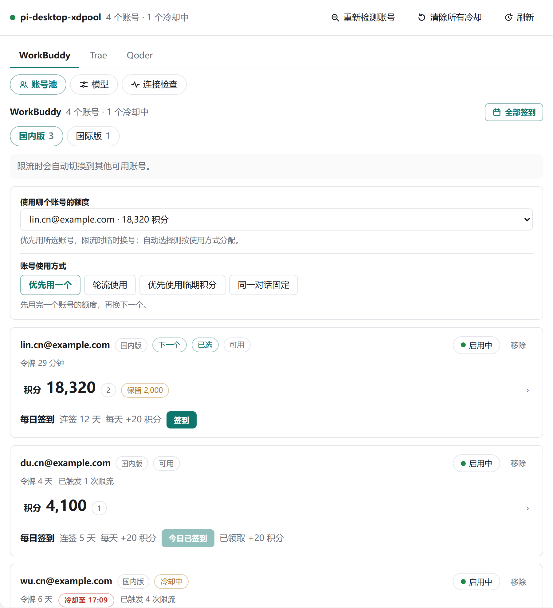

# pi-desktop-xdpool

把本机 WorkBuddy、Trae、Qoder 的桌面登录接进 PI-Desktop。WorkBuddy 被限流时自动换号。三家各有开关，国内与国际各自成组。

移植自 [XDTrees/dsh-workbuddy-xdpool](https://github.com/XDTrees/dsh-workbuddy-xdpool)（MIT）。Trae、Qoder 的协议参考见下方致谢。

## 预览

设置面板界面如下：


面板跟随 PI-Desktop 的外观设置，暗色与亮色各一套配色：



模型页可以改显示名、上下文窗口、输出上限、思考等级和贴图：


在线预览：<https://chengzhi-c.github.io/pi-desktop-xdpool/>（GitHub Pages）。

`docs/index.html` 是一个可交互的预览页：在浏览器中直接加载发布版的 `renderer/panel.js` 与 `panel.css`，
并接一个演示用的宿主桩。可切换来源与视图、调整模型参数、切换暗亮主题，上文截图即由该页面生成。
演示数据为虚构，不含真实账号或令牌。


本地运行：`node docs/serve.cjs`，然后打开它输出的地址。
（`docs/index.html` 需经本地服务器打开：`file://` 页面无法读取同目录的面板文件。）

## 安装

PI-Desktop → 插件 → 安装本地插件，选择发布包。

开发：`npm install && npm run typecheck && npm run build`。改 `src/` 后要重新构建，`lib/` 与 `src/` 一起提交。打包：`pwsh -File tools/pack.ps1`（包必须是不压缩的 store 格式）。

## 使用

在各家桌面 App 里登录，再点面板「重新检测账号」。WorkBuddy 要多个账号，就在 App 里逐个登录；5.6 起的 `$wbEncrypted` 登录由插件向本机已安装的 WorkBuddy 要密钥再读。Trae 国内版有 Trae CN 与 TRAE SOLO CN 两个登录位，Qoder 每个安装只保存一个登录，在 App 里重新登录会覆盖前一个。

模型分组没出现时，按面板顶部的提示重启 PI-Desktop。

面板顶层选来源，下面是账号池、模型和连接检查。

- 账号卡显示积分（点开一池一行）、签到、停用和移除。每个区域可以指定优先消耗哪个账号的额度。
- WorkBuddy 的使用方式有优先用一个、轮流使用、优先使用临期积分、同一对话固定。Trae 与 Qoder 有轮流使用和优先使用临期积分。
- 模型页勾选后保存，选择器跟着变。一个模型组最多发布 64 个，多出来的勾选标「未发布」，网关仍会服务它们。
- 签到可以单账号，也可以在标题栏一次领完该来源。自动签到默认每天 09:00（北京时间），错过的时间点下次启动补领，并顺带跑一趟猫猫旅行。Trae 的每日签到是一台设备一次。Qoder 的新一轮在每天 10:00（北京时间）开出。

## 设置

插件页里可改的项：

| 键 | 默认 | 说明 |
| --- | --- | --- |
| `enabled` | `true` | 关闭后网关不启动 |
| `sourceWorkbuddy` / `sourceTrae` / `sourceQoder` | `true` | 关闭后该来源不扫描、不发布、不请求 |
| `distribution` | `priority` | `priority` 先用一个账号，`round-robin` 均摊，`expiry` 优先消耗临期积分，`sticky` 同一对话固定 |
| `cooldownSeconds` | `60` | 限流冷却时长。上游报出重置时间时以它为准，按北京时间 |
| `catalogRefreshMinutes` | `30` | 模型目录刷新间隔 |
| `authFile` | `""` | WorkBuddy 登录文件路径；扫描其所在目录的全部 `.info` 登录，留空自动发现 |
| `showComposerPoints` | `false` | 在输入框工具栏显示当前账号积分 |

模型勾选和首选账号由面板保存。命令面板里也可以打开面板、重新检测、清除冷却、全部签到、连接检查。

## 端口

```
WorkBuddy  41831 / 41841
Trae       41851 / 41861
Qoder      41871 / 41881
```

宿主在插件进程启动前读取这些地址，所以端口固定。国内版请求只用国内版账号。

## 数据

只读三家 App 保存在本机的登录。令牌只在插件进程里使用，并只发往各家自己的接口。端点只听 `127.0.0.1`。同一台机器上的其他进程可以调用这些端点，从而消耗已登录账号的额度。

## 权限

| 权限 | 用途 |
| --- | --- |
| `ui.panel` | 打开设置面板 |
| `background.service` | 常驻运行网关与扫描 |
| `provider.register` | 把三个来源作为模型提供方写进本插件清单 |
| `renderer.extension` | 在输入框工具栏显示积分 |
| `clipboard.write` | 连接检查页复制报告 |

申请外发用不到 `net.fetch`：请求由插件进程按各家桌面 App 自己的登录直接发出，不经过宿主网络通道。

令牌只会发往以下主机，与 `manifest.json` 的 `safetyNotes` 一致：

- WorkBuddy：`copilot.tencent.com`、`www.codebuddy.cn`、`www.codebuddy.ai`、`www.workbuddy.ai`
- Trae：`api.trae.cn`、`solo.trae.cn`、`trae-api-cn.mchost.guru`、`coresg-normal.trae.ai`、`growsg-normal.trae.ai`
- Qoder：`gateway.qoder.com.cn`、`openapi.qoder.com.cn`、`api3.qoder.sh`、`openapi.qoder.sh`

## 致谢

本插件的若干模块移植或参考自下列 MIT 项目，特此鸣谢：

| 项目 | 版权 | 用于 |
| --- | --- | --- |
| [XDTrees/dsh-workbuddy-xdpool](https://github.com/XDTrees/dsh-workbuddy-xdpool) | (c) 2026 XDTrees | WorkBuddy 账号池与整体移植来源 |
| [corrinehu/dsh-workbuddy-connect](https://github.com/corrinehu/dsh-workbuddy-connect) | (c) 2026 Corrine Hu | 回环端点的安全模型 |
| [dingminhua/dsh-connect-workbuddy](https://github.com/dingminhua/dsh-connect-workbuddy) | (c) 2026 LaoDing | 上游接口与错误分类 |
| [dingminhua/dsh-connect-trae](https://github.com/dingminhua/dsh-connect-trae) | (c) 2026 dingminhua | Trae 协议参考 |
| [eghrhegpe/dsh-connect-qoder](https://github.com/eghrhegpe/dsh-connect-qoder) | (c) 2026 eghrhegpe | Qoder 协议参考 |
| [eric8bit/pi-desktop-workbuddy](https://github.com/eric8bit/pi-desktop-workbuddy) | (c) 2026 eric8bit | 同一上游的 PI-Desktop 移植版，本插件的前身 |

## 许可

MIT，见 [LICENSE](./LICENSE)。
